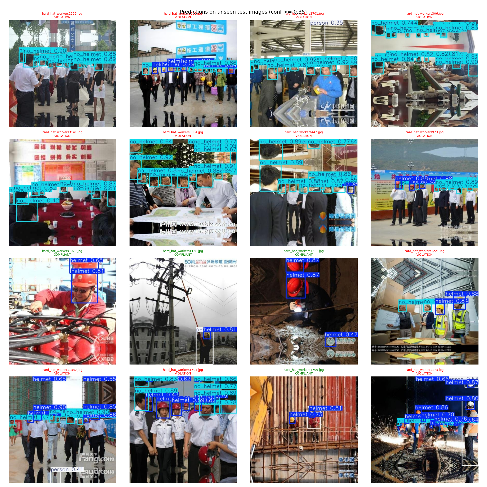

# 🦺 Safety Helmet Detection Using YOLOv8

**AIRI Team PITB — AI Internship Task 1 · End-to-End Computer Vision Project**
Author: **Hamza Nadeem** · Supervisor: Omar Farooq (Associate AI/ML Engineer)

An object-detection system that finds **helmets**, **bare heads (no helmet)** and **people** in workplace images and video, and labels each scene **COMPLIANT** or **VIOLATION**. The project covers the full workflow: problem definition → data collection & cleaning → manual annotation → YOLO dataset → training → evaluation → inference → error analysis → demo → report.



## Results

<!-- RESULTS:START -->
| Metric (test set) | Value |
|---|---|
| Precision | 0.727 |
| Recall | 0.655 |
| mAP@0.5 | 0.679 |
| mAP@0.5:0.95 | 0.401 |

| Class | Precision | Recall | mAP@0.5 | mAP@0.5:0.95 |
|---|---|---|---|---|
| helmet | 0.850 | 0.793 | 0.856 | 0.504 |
| no_helmet | 0.828 | 0.919 | 0.921 | 0.577 |
| person | 0.503 | 0.253 | 0.259 | 0.122 |

| Experiment | Model | Epochs | Train time | GPU | Val mAP@0.5 | Val mAP@0.5:0.95 |
|---|---|---|---|---|---|---|
| yolov8n_baseline | yolov8n.pt | 50 | 6.9 min | Tesla T4 | 0.717 | 0.455 |
| yolov8s_exp2 | yolov8s.pt | 50 | 6.5 min | Tesla T4 | 0.722 | 0.451 |

**Dataset:** 500 images (train: 349, val: 100, test: 51), manual Roboflow batch of 120 images prepared (import pending), 92 near-duplicates removed.
**Best model:** `yolov8n_baseline` -> `models/best.pt`
<!-- RESULTS:END -->

## Problem

| | |
|---|---|
| **Detects** | `helmet` (helmet worn on head), `no_helmet` (bare head), `person` |
| **Why** | Head injuries are severe and helmet rules are hard to enforce by watching cameras manually |
| **Where** | Construction sites, factories, warehouses, mines, plants, motorcycle road safety |
| **Output** | Boxes + class labels + confidence scores, and a COMPLIANT / VIOLATION status per image or frame |

## Dataset

- **Source:** [Hard Hat Workers — Kaggle `andrewmvd/hard-hat-detection`](https://www.kaggle.com/datasets/andrewmvd/hard-hat-detection) (MakeML; also on Roboflow Universe). **License: CC0 public domain.**
- 5,000 raw images → near-duplicates removed with perceptual hashing → **500 images curated** with a diversity-aware selection that guarantees every class and difficult conditions (small objects, low light, blur, crowds).
- **Manual annotation:** a stratified batch of 120 images annotated by hand in **Roboflow Annotate** (YOLOv8 export), then audited against the original labels.
- Source labels mapped: `helmet → helmet`, `head → no_helmet`, `person → person`; Pascal VOC → YOLO conversion done in the notebook.
- Stratified split **70 / 20 / 10** (train / val / test). Per-image sources: `outputs/data_analysis/dataset_sources.csv`.

## Method

| Step | Details |
|---|---|
| Model | YOLOv8n baseline + YOLOv8s experiment, COCO-pretrained (Ultralytics) |
| Training | 640 px, 50 epochs, batch 16, seed 42, Google Colab T4 GPU |
| Selection | Best experiment by **validation** mAP@0.5:0.95 → `models/best.pt` |
| Evaluation | Precision, Recall, mAP@0.5, mAP@0.5:0.95, per-class metrics, confusion matrix, loss curves (val + test) |
| Inference | Unseen test images at conf 0.35 + video inference with on-frame compliance banner |
| Error analysis | Automatic IoU matching → false positives / false negatives / wrong class / poor boxes, tagged with measured causes (small object, lighting, blur, occlusion, image edge, missing labels), plus manual review of 12 cases |

## Repository structure

```
cv_project/
├── dataset/                 # YOLO-format dataset
│   ├── images/{train,val,test}/
│   ├── labels/{train,val,test}/
│   └── data.yaml
├── notebooks/training_notebook.ipynb   # the whole pipeline, run on Google Colab
├── outputs/
│   ├── training_results/    # Ultralytics runs (weights, results.csv, curves) per experiment
│   ├── evaluation/          # val/test metrics, confusion matrices, loss curves
│   ├── predictions/         # ≥15 annotated test predictions + compliance CSV
│   ├── error_analysis/      # error table, all errors CSV, case images
│   ├── data_analysis/       # sources manifest, duplicates, diversity plots, annotation audit
│   └── demo_results/        # annotated video + demo outputs
├── models/best.pt
├── report/final_report.pdf  # + linkedin_portfolio_report.md
├── app/                     # Streamlit + Gradio (Hugging Face Spaces) demos
├── docs/                    # setup guide + annotation guidelines
├── README.md
└── requirements.txt
```

## How to run

1. Upload the whole `cv_project` folder to **Google Drive → My Drive**.
2. Open `notebooks/training_notebook.ipynb` with Google Colab, set **Runtime → T4 GPU**.
3. Run the cells top to bottom. At Phase 3, annotate the prepared batch in Roboflow and upload the export (see `docs/SETUP_GUIDE.md`).

Full step-by-step instructions: [`docs/SETUP_GUIDE.md`](docs/SETUP_GUIDE.md).

### Run the demo locally

```bash
pip install -r requirements.txt
streamlit run app/streamlit_app.py          # Streamlit
python app/gradio_app.py                    # Gradio (same file works on Hugging Face Spaces)
```

### Use the model in Python

```python
from ultralytics import YOLO
model = YOLO("models/best.pt")
results = model.predict("site_photo.jpg", conf=0.35, save=True)
```

## Limitations & next steps

- The public source labels for `person` are incomplete, so measured `person` precision understates the real performance; re-annotating the full set would fix this.
- Far-away workers (tiny heads) remain the hardest case — higher input resolution or tiled inference would help.
- Next: CCTV footage from local sites, object tracking so each violation is counted once per worker, and an alerting dashboard.

## Acknowledgements

Dataset: *Hard Hat Workers* by MakeML (CC0), via Kaggle (andrewmvd). Model: [Ultralytics YOLOv8](https://docs.ultralytics.com). Annotation: [Roboflow](https://roboflow.com).
